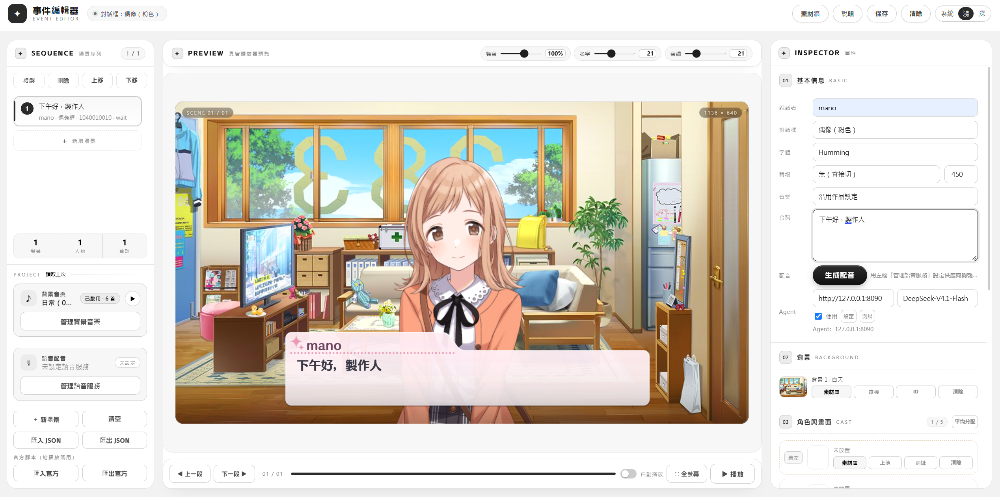
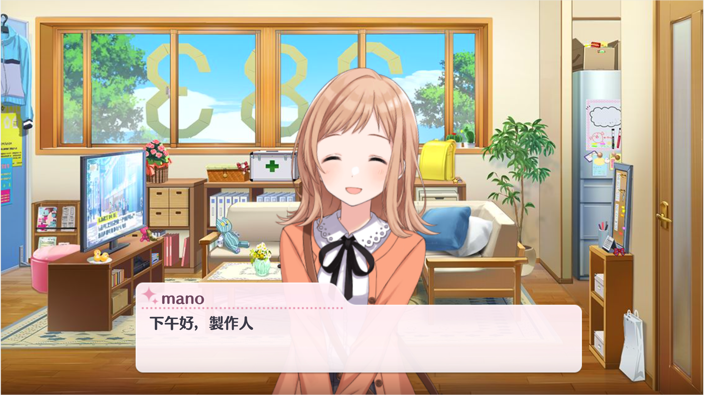

# 事件編輯器（Shiny Colors Event Editor）

用 enza 的 Spine 角色、背景與對話框，編排自己的二創劇情，並可接本機 TTS 配音。

> 本專案只包含**程式碼**。遊戲素材（背景、Spine、字型、語音）與劇情文本**不在 repo 內**，請自備。

## 介面

編輯器（三欄：場景序列／即時預覽／屬性）：

播放模式（全螢幕）：

## 功能

- 三欄編輯器：場景序列 / 即時預覽 / 屬性面板
- 最多 5 個角色位置（最左、左、中、右、最右），Spine 骨骼動畫＋表情＋嘴型
- 對話框（粉/藍框）、字型（含 enza 原版 Humming / UDKakugo / Yuanti）
- 轉場：黑場／白場／背景淡入／溶解
- 純色介面（淺色／深色，跟隨系統）
- 匯出 JSON（EventViewer 格式）、官方格式匯入／匯出
- 配音：本機 Irodori TTS（8088）＋風格 Agent API（8090）
- 角色語體資料包：29 位角色的官方統計（`資料/style`）

## 快速開始

1. 下載或 clone 本 repo
2. 準備素材（見 `素材/README.md`）
3. Windows：雙擊 `sc-export\run-server.cmd`，開啟 `http://127.0.0.1:8000/sc-editor/`

> Spine 動畫必須用 http 開啟（file:// 會被 CORS 擋）。

## 配音（可選）

| 服務 | 用途 | 啟動 |
|---|---|---|
| 8088 | Irodori TTS（本機模型） | 自備 `python hski_api.py --port 8088` |
| 8090 | 風格 Agent API（翻譯＋語體檢查＋配音） | `agent\啟動AgentAPI.bat` |

Agent API 需要 OpenAI 相容的 API key：在 `agent/llm-config.json` 填入 `base_url` / `model` / `api_key`（此檔已被 gitignore）。

## 角色語體

`資料/style/`：

- `style-spec.json`：29 位角色的語体、敬語率、一人稱、句長、語尾、方言、禁止形式
- `翻译参数表.md`：原始統計表
- `style_lookup.py`：零依賴查詢工具（`python style_lookup.py --speaker 月岡戀鐘 --text "..."`）
- `prompt-template.md`：可直接貼給任何 agent 的 system prompt

## 授權

- **程式碼**：MIT（見 `LICENSE`）
- **遊戲素材**：©Bandai Namco Entertainment Inc.，僅供個人二創，**不得隨 repo 散布**
- **語體統計**：由官方劇本統計出的衍生數據，可自由使用；原始台詞（corpus）不包含在 repo 內

## 致謝

- enza / THE iDOLM@STER SHINY COLORS（Bandai Namco）
- pixi.js / pixi-spine
- Irodori-TTS